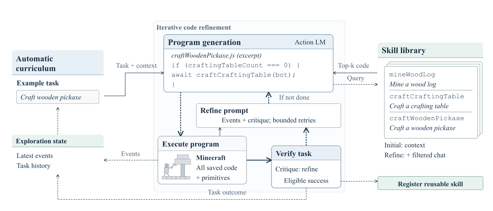

# PaperFigure

An installable Codex skill for **AI research paper architecture figures and method
overviews**. It focuses on scientific traceability, deliberate visual composition,
and editable PowerPoint output. Experimental data charts and slide decks are out
of scope.

The current examples use **solid semantic colors**, native editable text/shapes and
source-reviewed graphs. The new real-agent cases are ReAct, Reflexion and Voyager;
see the [source/author comparison and checks](docs/AGENT_PAPERS_COMPARISON.md).
BLIP-2 also has a reviewed solid-fill revision. Earlier LLaVA layouts and gradient
studies remain as design history, not the current styling default. Earlier generic
VLM/V2 failures are retained in the [rejection audit](docs/V2_USER_REJECTION_AUDIT.md).

The MVP connects Codex's method understanding to a deterministic local renderer:

**Source → evidence-backed figure JSON → optional generated design reference →
native editable reconstruction → automated checks + visual review.**

The CLI starts from JSON. Natural-language, paper, code and sketch understanding
runs in Codex through the skill; it is not a separately implemented NLP service.

## Faithful PNG reconstruction

When a supplied PNG is the target, PaperFigure preserves its visual design instead
of generating a different layout. The [PNG reconstruction workflow](paperfigure/references/png-reconstruction.md)
requires native text, independently editable vector elements, semantic SVG groups,
iterative rendering/region comparison, and a separately inspected native PPTX.
Unrecoverable fonts/details and any lower-editability exceptions are disclosed.
This is agent-assisted authoring, not an automatic PNG vectorizer or arbitrary
SVG-to-native-PPTX converter. The current flat scene exporter does not itself
provide semantic SVG `<g>` groups; this mode must author/verify them explicitly.

Render and diagnose an authored reconstruction:

```bash
node paperfigure/scripts/reconstruction-check.mjs \
  --reference /path/to/original.png --svg /path/to/figure.svg \
  --inventory /path/to/inventory.json --out /path/to/new-comparison
```

On structurally valid inputs this emits native-ledger findings and
preview/overlay/difference/side-by-side images for inspection; invalid inputs emit
a failed report without rendering. Pixel error never grants visual acceptance; an isolated reviewer
must compare to the original. See [test results](docs/test-results-png-reconstruction.txt)
for the diagnostic tool checks, not evidence of a real-paper reconstruction.

## Examples

ReAct, Reflexion and Voyager are based on pinned official code; BLIP-2 is a
source-audited VLM case. LLaVA is a paper-grounded historical design study. The
tool-memory and physical-VLN examples are illustrative software fixtures. None
of these figures claims new scientific results.

| Example | Preview | Editable source | Exports |
| --- | --- | --- | --- |
| BLIP-2 OPT (solid-fill code case) | [PNG](paperfigure/examples/blip2-opt-code/output-solid/preview.png) | [PPTX](paperfigure/examples/blip2-opt-code/output-solid/figure.pptx) | [SVG](paperfigure/examples/blip2-opt-code/output-solid/figure.svg), [PDF](paperfigure/examples/blip2-opt-code/output-solid/figure.pdf) |
| ReAct / HotpotQA | [PNG](paperfigure/examples/react-hotpotqa/output-reviewed/preview.png) | [PPTX](paperfigure/examples/react-hotpotqa/output-reviewed/figure.pptx) | [SVG](paperfigure/examples/react-hotpotqa/output-reviewed/figure.svg), [PDF](paperfigure/examples/react-hotpotqa/output-reviewed/figure.pdf) |
| Reflexion / same-question retries | [PNG](paperfigure/examples/reflexion-hotpotqa/output/preview.png) | [PPTX](paperfigure/examples/reflexion-hotpotqa/output/figure.pptx) | [SVG](paperfigure/examples/reflexion-hotpotqa/output/figure.svg), [PDF](paperfigure/examples/reflexion-hotpotqa/output/figure.pdf) |
| Voyager / automatic curriculum | [PNG](paperfigure/examples/voyager-agent/refinement/output-final/preview.png) | [PPTX](paperfigure/examples/voyager-agent/refinement/output-final/figure.pptx) | [SVG](paperfigure/examples/voyager-agent/refinement/output-final/figure.svg), [PDF](paperfigure/examples/voyager-agent/refinement/output-final/figure.pdf) |
| LLaVA architecture (paper-grounded) | [PNG](paperfigure/examples/llava-paper/output/preview.png) | [PPTX](paperfigure/examples/llava-paper/output/figure.pptx) | [SVG](paperfigure/examples/llava-paper/output/figure.svg), [PDF](paperfigure/examples/llava-paper/output/figure.pdf) |
| Tool + memory language agent | [PNG](paperfigure/examples/tool-memory-agent/output/preview.png) | [PPTX](paperfigure/examples/tool-memory-agent/output/figure.pptx) | [SVG](paperfigure/examples/tool-memory-agent/output/figure.svg), [PDF](paperfigure/examples/tool-memory-agent/output/figure.pdf) |
| Embodied navigation agent | [PNG](paperfigure/examples/physical-vln/output/preview.png) | [PPTX](paperfigure/examples/physical-vln/output/figure.pptx) | [SVG](paperfigure/examples/physical-vln/output/figure.svg), [PDF](paperfigure/examples/physical-vln/output/figure.pdf) |



The new [BLIP-2 code case](paperfigure/examples/blip2-opt-code/README.md) adds
a pinned source audit, preserved pre-author figure freeze, explicit concatenation
and a semantic palette. See the [scoped author comparison](docs/BLIP2_COMPARISON.md).
Colors encode scientific categories, not arbitrary module identities.
The [Voyager main-figure refinement](docs/VOYAGER_REFINEMENT.md) adds a separate
visual-quality rejection/review cycle, concrete released skill code and a more
focused iterative-refinement layout.

Build the new source-audited agent set into a fresh directory:

```bash
node paperfigure/scripts/agent-examples.mjs /tmp/my-new-agent-figures
```

See [agent reproduction instructions](paperfigure/examples/agent-papers/README.md)
for source generators and independent render commands. The latest verification is
[46 passing tests](docs/test-results-agent-papers.txt); actual source and visual
reviews remain separate from automated test results.

## Install in Codex

Requirements: Node.js 20+ and npm. Run from this repository:

```bash
npm --prefix paperfigure ci
node paperfigure/scripts/install.mjs
```

The installer copies the self-contained skill to `$CODEX_HOME/skills/paperfigure`,
or `~/.codex/skills/paperfigure` when `CODEX_HOME` is unset. It refuses to overwrite
an existing installation and prints the dependency-install command for that copy.
Run that command, then start a new Codex chat and invoke `$paperfigure`.
For a custom new destination:

```bash
node paperfigure/scripts/install.mjs /absolute/path/to/skills/paperfigure
npm --prefix /absolute/path/to/skills/paperfigure ci
```

No paid service or API key is required. Optional image generation uses the host's
built-in tool when available; no provider API is silently called. LibreOffice and
Poppler are optional for independent PowerPoint/PDF verification. Unicode PDF
labels require usable installed font files, resolved through fontconfig or macOS
supplemental fonts. PDF export embeds those fonts rather than silently dropping
math glyphs; fonts are not bundled or redistributed in the skill.

## Use

Example Codex request:

> Use $paperfigure to turn this Method into an editable architecture figure for
> a double-column AI paper. Read the method before drawing. Highlight only the
> stated contribution. Keep the figure free of a title, footer or footnote.

The skill records source evidence and the interpreted semantic graph, designs the
layout, renders outputs, inspects actual previews, and repairs detected issues.
You can also generate the checked examples directly:

```bash
npm --prefix paperfigure run examples -- /tmp/my-new-agent-run
npm --prefix paperfigure test
```

Generate a new output directory from a specification:

```bash
node paperfigure/scripts/paperfigure.mjs build \
  --spec paperfigure/examples/blip2-opt-code/spec-solid.json --out ./my-figure
```

Outputs include editable PPTX, SVG, vector PDF, high-resolution PNG, smaller preview,
Draw.io source, original spec, resolved scene, QA results, and reproducibility
manifest. A detected QA error returns exit code 2 and retains the diagnostic
artifacts. Input/schema errors return 1. Existing outputs are protected; `--force`
requires an output carrying a PaperFigure manifest.

## Font and caption defaults

**No visible title, subtitle, footer or footnote by default.** LaTeX supplies the
caption. Metadata retains the title without printing it. Necessary meanings stay
in module labels or local edge labels, rather than unexplained visual-token grids.

Adjust fonts in the specification:

```json
"typography": {
  "fontFamily": "Arial",
  "moduleSize": 26,
  "detailSize": 23,
  "annotationSize": 23
}
```

Or use `build --font-family Helvetica --font-scale 1.05`. An individual node's
`layout.nodes.ID.fontSize` overrides its module-label size. All PPTX labels are
native text boxes and can also be changed directly in PowerPoint. Regenerate from
the specification to keep SVG/PDF/PPTX synchronized after a change. Resizing text
can require layout changes; the checks report overflow rather than shrinking text
silently. Arial text, Times New Roman math, native subscripts and Greek phi were
checked in the current LLaVA PNG/PPTX/PDF. This does not establish general coverage
for every script or installed font. Explicit per-artwork math fonts override the
global default and remain independently editable.

## Verification and limits

```bash
node paperfigure/scripts/paperfigure.mjs qa --out ./my-figure
node paperfigure/scripts/render-check.mjs ./my-figure
```

Automated checks cover schema, evidence-quote traceability, phases, group hierarchy,
node/edge inventories, original text, bounds/overlaps, route occlusion/crossings,
publication text size, native editability and SVG/PPTX geometry. PPTX paths are grouped native connector segments. They retain editable geometry
but are not auto-attached to modules; moving a module requires route adjustment.

Mechanical checks do not prove scientific entailment or top-conference aesthetics.
A separate `review-status --out DIRECTORY` gate requires an attributed independent
review bound to the reference and exact inspected artifact hashes. It refuses
missing, rejected or stale reviews. Declared complex input illustrations can remain
independent pictures; architecture text, modules, motifs and routes remain native.
The current LLaVA has one visible input-photo crop and approximately 98.9% native
objects. Its native gradients, editable math runs, picture viewport and PDF font
embedding are checked. A retained full reference bitmap supplies only the photo
crop; it is not the visible architecture body.
Independent LibreOffice rendering is verified separately; actual Microsoft
PowerPoint interaction and human editing time remain unmeasured. Image generation
can propose unsupported details, which must be removed during reconstruction.

See the [current LLaVA verification record](docs/LLAVA_RECONSTRUCTION.md),
[baseline implementation report](docs/IMPLEMENTATION.md),
[reference-project analysis](docs/REFERENCE_RESEARCH.md), and
[next phases](docs/ROADMAP.md). The skill is self-contained under `paperfigure/`;
none of its runtime files depend on repository-level documentation or other
installed skills.

## Licensing

Original implementation is provided under [MIT](LICENSE). Reference projects were
studied without copying their implementations or figure assets. Their distinct
licenses and the reviewed revisions are recorded in the research report. Paper
figure reuse is not implied by open access; the corpus defaults to link-only
metadata until rights are documented. This repository has not been published or
connected to a GitHub remote by the implementation workflow.

### Measured text and editable arrow repair

See the [layout workflow](paperfigure/references/layout-and-arrows.md) and [two frozen 2026 agentic-paper tests](paperfigure/examples/agentic-2026-layout/README.md) for native SVG/PPTX reconstruction, measured padding/centering, obstacle-aware routing, exact source-occlusion exceptions, and independently rendered editing checks.

### Reference and typography reliability

Use semantic `build` for new design and reference-bound `reconstruct` for a selected PNG. A target needs frozen module regions and a source-aware typography profile; native text does not by itself prove font fidelity. See [reference routing](paperfigure/references/reference-routing.md) and [typography](paperfigure/references/typography.md). The accepted AgeMem/MemSkill artifacts remain immutable regression fixtures. LATS evaluation is suspended while this reliability work is completed.


### Skill organization and shared delivery state

PaperFigure remains one skill. Its compact [entrypoint](paperfigure/SKILL.md)
routes to [new design](paperfigure/references/design-workflow.md) or
[reference reconstruction](paperfigure/references/reference-routing.md); historical
case rules live in the [case guide](paperfigure/references/case-guide.md).
The two scene/export pipelines remain distinct. Their shared validation and
acceptance policy is implemented in `scripts/delivery-status.mjs`, with a
[versioned status contract](paperfigure/references/evaluation.md#shared-validation-and-delivery-contract).
Both routes support `qa --out DIRECTORY` and `review-status --out DIRECTORY`.
`delivery.json` reports mechanical, render and review stages separately; all must
pass for readiness. Existing review records are supported, while route-specific
acceptance strings are normalized to `independently-accepted`, `needs-revision`
or `unreviewed`. Accepted example artifacts remain unchanged.

See the [architecture and verification record](docs/SKILL_ARCHITECTURE.md).

The [2026-11-16 end-to-end replay](docs/runs/2026-11-16-skill-e2e/REPORT.md)
adds actual Office rendering and fresh independent review for both routes. The
initial Voyager design was visually rejected despite mechanical success; its
readability revision and the AgeMem reference reconstruction pass the final gate.
This is evidence for two existing authored cases, not automatic high-quality
figure design from arbitrary paper code.

The [Voyager ImageGen-first pilot](docs/runs/2026-11-16-voyager-imagegen-loop/REPORT.md)
runs code-grounded design through isolated raster review and three actual
attached-image edits before a small native sample. The selected PNG is image-stage
accepted; complete SVG/PPTX reconstruction remains downstream. This route preserves
visual design before native export rather than substituting a generic layout.

The [Agentless figure-hidden case](docs/runs/2026-11-16-agentless-figure-hidden/REPORT.md)
uses sanitized method prose and eight pinned official code files without opening
author figures/captions. One initial ImageGen image and two attached-image edits
produced an independently accepted image-stage reference. Native/Office conversion
is unverified; this is one in-run figure-hidden case, not a held-out generalization
benchmark or a claim that model prior knowledge was excluded.

The [Agentless narrative-first redesign](docs/runs/2026-11-17-agentless-narrative/REPORT.md)
adds an explicit information-selection and paper-story stage before composition.
The paper-level overview was source/narrative reviewed, generated once, refined
with three actual attached-image edits, and independently accepted at the raster
stage before author-figure comparison. This run is author-informed, not figure-hidden;
editable/native and Office delivery remain downstream.
The user subsequently rejected its contribution emphasis as too procedural;
the historical acceptance remains recorded and native planning is disabled.

The [contribution-oriented Agentless revision](docs/runs/2026-11-17-agentless-contribution/REPORT.md)
adds a source-grounded contribution hierarchy to the skill: distinguish the paper's
central claim, its supporting design choices and established support operations,
then map each in-scope distinction to a visible mechanism. Its composition uses
source narrowing and local-edit magnification rather than equal numbered cards.

The [Agentless native reconstruction](docs/runs/2026-11-17-agentless-native/REPORT.md)
preserves that selected design in editable SVG/PPTX. Actual LibreOffice rendering,
font/route checks and fresh isolated fidelity review pass the shared delivery gate.
The deck contains native text, shapes and connectors with zero pictures/media.
A white-text isolation false positive was reproduced and repaired with contrasting
mattes; the initial failure and regression tests are retained. Microsoft PowerPoint
interactive editing and exact source-font identity remain outside this acceptance.

The [ImageGen skill optimization](docs/runs/2026-11-17-imagegen-skill-optimization/REPORT.md)
adds version 1.1 contribution-bound prompts, same-budget composition comparison and
an image-only first-reading handoff before source-informed pixel review. Legacy
version 1.0 prompt output stays unchanged. Offline Agentless examples compile two
bound layouts; no image generation, new visual comparison or quality gain is claimed
by this software/workflow validation alone.

The [MAE high-quality-original case](docs/runs/2026-11-17-mae-high-quality/REPORT.md)
runs the optimized protocol on CVPR 2022 MAE with two actual composition candidates,
one attached-image correction, image-only reading, source-informed grid auditing,
full native SVG/PPTX, actual LibreOffice rendering and isolated final review. The
shared delivery gate passes. This is author-informed: the original remains more
economical; the new design makes mask insertion and masked-only loss more explicit.
It does not establish superior design or automatic arbitrary-code figure generation.
