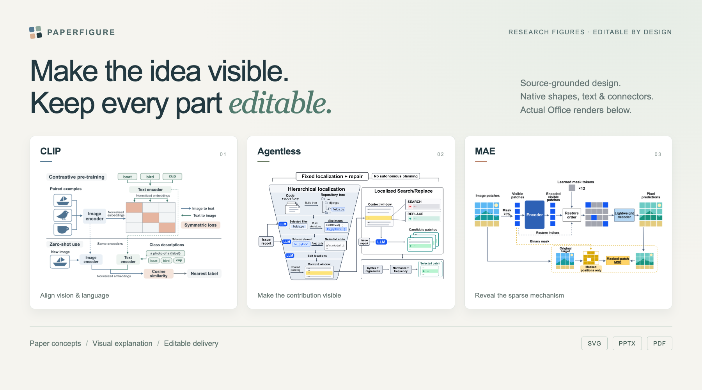
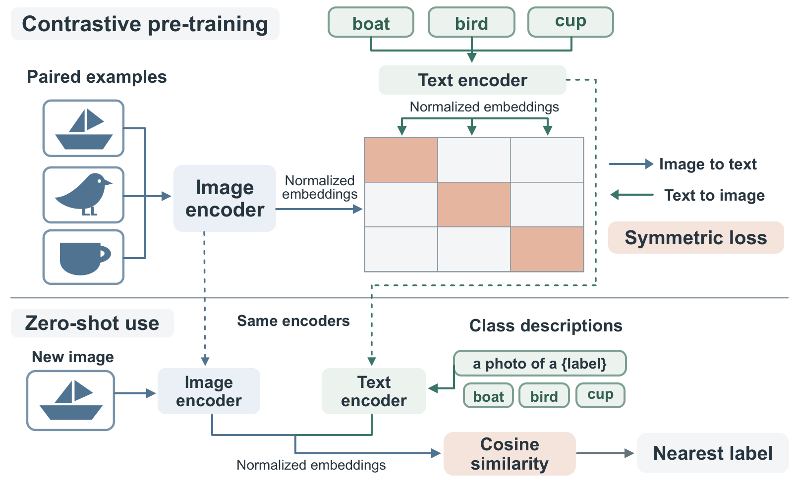
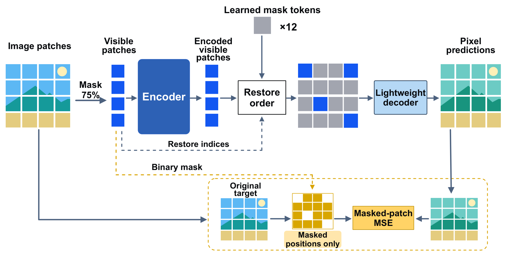

<a href="#examples"></a>

<p align="center">
  <a href="#examples">Examples</a> ·
  <a href="#visual-styles">Styles</a> ·
  <a href="#install">Install</a> ·
  <a href="#how-it-works">Workflow</a> ·
  <a href="paperfigure/SKILL.md">Skill</a> ·
  <a href="docs/USAGE.md">Reference</a>
</p>

```sh
npx skills add abs1903/PaperFigure2PPT --skill paperfigure --agent codex --global
```

One installable skill at [`paperfigure/`](paperfigure/SKILL.md). The `skills` CLI
requires Node.js 22.20+; this private repository requires GitHub access. After
installation, start a new Codex chat and invoke `$paperfigure`.

## Examples

These figures use the current image-first workflow: source and contribution planning,
ImageGen design, isolated review, then faithful native reconstruction. The previews
below are **actual LibreOffice renders of the downloadable PPTX files**. Click any
figure to inspect it at full resolution.

### CLIP · Alignment becomes a classifier

A cross-modal pairing matrix makes the learning objective visible; a separate
zero-shot region shows how language descriptions define the classes.
Shown with pale role surfaces; the [original and alternative palette](docs/runs/2026-11-17-color-study/clip-palette-comparison.png) are retained as a matched paint-only study.

<a href="docs/runs/2026-11-17-color-study/clip-soft-dual/native-render/preview.png"></a>

**[PowerPoint](docs/runs/2026-11-17-color-study/clip-soft-dual/figure.pptx)** · [SVG](docs/runs/2026-11-17-color-study/clip-soft-dual/editable.svg) · [PDF](docs/runs/2026-11-17-color-study/clip-soft-dual/native-render/figure.pdf) · [Source & review](docs/runs/2026-11-17-color-study/REPORT.md)

---

### Agentless · Narrow the search, focus the edit

A narrowing repository funnel exposes hierarchical localization. The enlarged edit
window makes localized Search/Replace distinct from unconstrained planning.

<a href="docs/runs/2026-11-17-agentless-native/output-v2/native-render/preview.png"></a>

**[PowerPoint](docs/runs/2026-11-17-agentless-native/output-v2/figure.pptx)** · [SVG](docs/runs/2026-11-17-agentless-native/output-v2/editable.svg) · [PDF](docs/runs/2026-11-17-agentless-native/output-v2/native-render/figure.pdf) · [Source & review](docs/runs/2026-11-17-agentless-native/REPORT.md)

---

### MAE · Encode less, reconstruct the full image

The sparse encoder lane expands only after mask tokens are inserted. A separate
objective inset preserves the distinction between full prediction and masked-only loss.

<a href="docs/runs/2026-11-17-mae-high-quality/output-v2/native-render/preview.png"></a>

**[PowerPoint](docs/runs/2026-11-17-mae-high-quality/output-v2/figure.pptx)** · [SVG](docs/runs/2026-11-17-mae-high-quality/output-v2/editable.svg) · [PDF](docs/runs/2026-11-17-mae-high-quality/output-v2/native-render/figure.pdf) · [Source & review](docs/runs/2026-11-17-mae-high-quality/REPORT.md)

All three cases retain native text, shapes and connectors with **zero embedded
pictures**. Source, actual-render and independent-review evidence are recorded for
each output. These are author-informed explanatory designs, not new experimental
results or claims to outperform the original paper figures.

Earlier ReAct, Reflexion, Voyager, BLIP-2 and LLaVA studies remain available in the
[case archive and technical reference](docs/USAGE.md#examples).

## Visual styles

The skill saves [mechanism-specific visual profiles](paperfigure/assets/visual-styles.json)
and [original palette families](paperfigure/assets/palette-families.json), with its own
preview images, adaptation rules and source attribution. The [reference guide](paperfigure/references/color-and-hierarchy.md)
records actual inspection of 12 ICLR 2026 and 4 CVPR 2026 method figures; it does
not prescribe a single conference style.

- **Role surfaces:** pale supporting modules, readable dark ink and a focal relation.
  Compare [soft blue/green](paperfigure/assets/styles/clip-soft-dual.png) and
  [plum/sage](paperfigure/assets/styles/clip-plum-sage.png).
- **Token continuity:** repeated representation categories with consistent local cues;
  [MAE example](paperfigure/assets/styles/mae-token-lane.png).
- **Focus and detail:** one overview with a scientifically meaningful enlarged region;
  [Agentless example](paperfigure/assets/styles/agentless-focus.png).
- **Line-first:** restrained structural ink with explicitly labeled relation accents;
  source-linked guidance, without a claimed new accepted project example.

Profiles include composition, glyphs, typography, borders/routes, suitable mechanisms
and failure modes. Paper source art remains link-only; bundled examples are our own
native schematics. See the [style study and verification](docs/runs/2026-11-17-color-study/REPORT.md).

## Install

Install directly from GitHub with the `skills` CLI (1.9.0 tested):

```sh
npx skills add abs1903/PaperFigure2PPT --skill paperfigure --agent codex --global
```

Omit `--global` to install into the current project. The explicit skill URL is
[the `paperfigure` skill directory on GitHub](https://github.com/abs1903/PaperFigure2PPT/tree/main/paperfigure).
You can also give that URL to Codex's Skill Installer. Existing Git or GitHub CLI
authentication must have access to this private repository.

Start a new Codex chat and invoke `$paperfigure`. Its first-use bootstrap installs
missing locked Node dependencies inside the installed skill. A usable Chromium
is needed for measured SVG QA; bootstrap can download it with `--with-chromium`
if no existing browser is found. Installing files alone does not install Office.

The skill runtime requires Node.js 20+ and npm. The GitHub installer above requires
Node.js 22.20+. See the [packaged installation guide](paperfigure/references/installation.md)
for setup, checks and the local-checkout alternative; the [technical reference](docs/USAGE.md#install-in-codex)
retains the manual installer workflow.

Image generation uses the host's built-in tool when available; no external provider
API is called silently. Independent PowerPoint verification requires LibreOffice.
Deterministic native authoring is also available without image generation.

## Try it

> Use $paperfigure to read this paper and its official code, identify the central
> contribution, and design a clear method overview. Compare two visual compositions,
> review the generated image independently, then deliver an editable SVG and PPTX
> with an actual Office render. Keep the figure free of an overall title or footer.

For a supplied figure, ask to preserve its design while reconstructing native
editable elements. Text, modules and connectors remain editable; exact font identity
and interactive Microsoft PowerPoint behavior are not guaranteed by an Office render.

## How it works

**Sources → contribution plan → ImageGen candidates → isolated review → native SVG/PPTX → Office render → final review**

The paper story determines what gets visual emphasis. ImageGen explores the design;
the reviewed image is then frozen as a reconstruction target. SVG and PPTX are
built from the same authored scene, inspected and independently rendered.

The shared `delivery.json` gate separates **mechanical**, **render** and **review**
status. Every stage must pass before an output is marked ready. Rejected candidates,
source evidence and earlier versions are retained alongside the accepted files.

This is an agent-assisted skill, not a one-command paper parser or automatic PNG
vectorizer. See the [skill entrypoint](paperfigure/SKILL.md),
[image-first workflow](paperfigure/references/image-reference.md),
[native reconstruction](paperfigure/references/png-reconstruction.md) and
[CLI / verification reference](docs/USAGE.md).

## License

Original implementation: [MIT](LICENSE). Paper text, official source snapshots,
fonts and author figures retain their respective rights; each case records its
provenance. Displayed showcase figures use newly authored schematic artwork.
