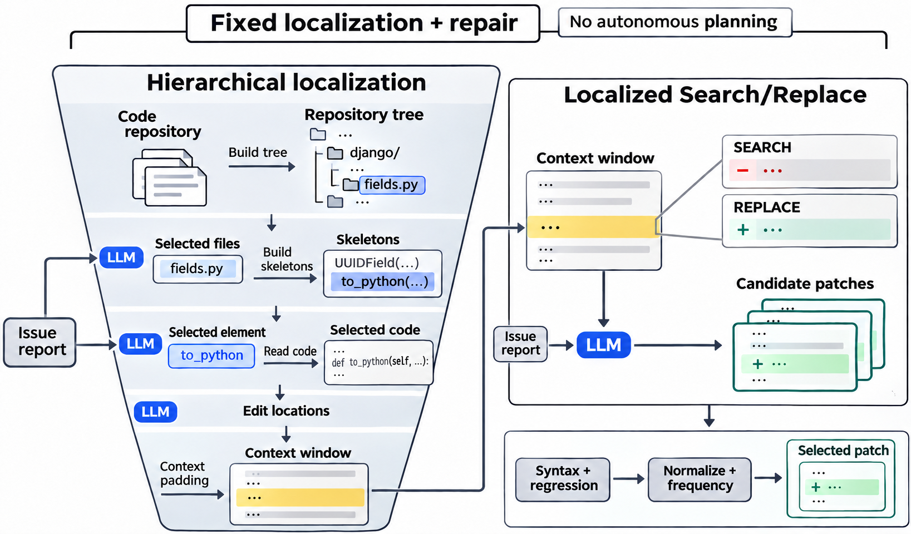

# Agentless contribution-oriented revision

Date: 2026-11-17. This revision responds to the user's rejection of the previous equal-card overview as too procedural and insufficiently explicit about the contribution. It is an author-informed raster design exercise, not a figure-hidden experiment, reader study, or native/Office delivery.

Final result: independent raster acceptance for V3, including contribution visibility; SVG/PPTX and Office delivery remain unverified.

Downstream update: editable SVG/PPTX reconstruction, actual LibreOffice rendering and isolated fidelity review are now complete with all delivery stages passed. See [native delivery](../2026-11-17-agentless-native/REPORT.md) and `native-delivery.json`. Earlier image-stage records retain their original scope.

## What changed conceptually

The previous pass established source fidelity and a readable sequence, but those checks did not ensure that the figure explained the paper's design contribution. The skill now requires `contributionHierarchy`: central claim → supporting design distinctions → source evidence → visible mechanism/prominence. Independent pixel review must identify which distinction the image actually explains; execution order alone is insufficient.

The updated guidance is in [paper-narrative.md](../../../paperfigure/references/paper-narrative.md), with concise routing in the skill entry and ImageGen/visual-review references. It distinguishes a new primitive from a contribution made by combining established techniques. It also keeps out-of-scope dataset/evaluation contributions separate from the method computation graph.

## Source-grounded contribution hierarchy

Source: [Agentless, arXiv:2407.01489v1](https://arxiv.org/pdf/2407.01489v1), Abstract/Introduction and Section 2, PDF pp.1–5. The actual raw extracts are retained. Section 2 explicitly describes the individual techniques as non-revolutionary; this figure does not label Search/Replace, regression tests or voting as independently invented methods.

| Role | Source-supported choice | Visible encoding |
| --- | --- | --- |
| Central design | A fixed localization-and-repair procedure, without autonomous action planning | Explicit framing bracket: Fixed localization + repair / No autonomous planning; bounded LLM tasks, no agent controller |
| Focal mechanism | Hierarchical localization with concise repository/skeleton/source representations | One progressively narrowing source illustration; recurring file/element identifiers; selected interval retains surrounding source |
| Focal mechanism | Localized Search/Replace edits rather than generating complete replacement code | Source-interval magnification into SEARCH/REPLACE; unchanged surrounding context remains visible; multiple local candidates |
| Support | Syntax/regression checks and normalized frequency ranking | Small deterministic support strip; not an equal-sized primary card |
| Separate paper contribution | Benchmark audit and SWE-bench Lite-S | Retained in contribution plan as outside this method illustration, not inserted as a processing module |

Repeated UUIDField/to_python identifiers derive from the paper's skeleton example. Strokes and edit strips are schematic, not an executed bug/patch or a newly measured successful repair. Exact output serialization and later-code fallback behavior remain outside the scope.

## Actual review and image-edit record

The isolated reviewer `/root/agentless_narrative_review` retains its original fresh-context separation and does not author the images/spec/brief it accepts. The prior accepted raster remains stored, with the user's `revise` feedback overriding readiness in that earlier case.

- Source/contribution draft 1: revise. Generic Fixed control did not name the source-specific design distinction.
- Source/contribution draft 2: accepted for generation after making fixed localization/repair and absence of autonomous planning explicit.
- Image V1: contribution visibility passed; overall revise for issue-input binding and an unexplained upper bypass line.
- Image V2, real attached edit: issue bindings corrected, but the tool introduced a focused-context → filtering bypass, leaving the generation context disconnected. Rejected.
- Image V3, real attached edit: targeted restoration of the focused-context handoff into local generation. Independently accepted for the exact raster. The final report includes the limited reference comparison.

Actual calls: one built-in ImageGen generation, two `referenced_image_paths` edits. Source/spec/plan/brief stayed frozen throughout image edits. The tool's unwanted routing change is retained as failure evidence rather than inferred away from the delta prompt.

## Qualitative comparison

The independent reviewer finds V3 more explicit about contribution mechanisms than the prior uniform-card pipeline. Source narrowing explains bounded-context localization, interval magnification explains localized edits, and the central fixed-workflow/no-planning claim is stated rather than left implicit. The author figure remains stronger in concrete issue/prompt and code-artifact grounding. This is a targeted communication gain, not an overall superiority result or a new claim that each technique is novel.

## Evidence and delivery boundary

- [Selected raster](selected-reference.png), [selected-image identity](selected-reference.json), [image-stage status](image-stage.json), [round ledger](rounds.json).
- [Contribution plan](narrative-plan.json), [source spec](spec.json), [communication brief](design-brief.json), [source/contribution review](source-contribution-review-v2.md).
- [V1 review](image-review-v1.md), [V2 review](image-review-v2.md), [final V3 review](image-review-v3.md).
- [Initial prompt](prompt-generate-v1.txt), [wiring edit](prompt-edit-v2.txt), [focused-context handoff correction](prompt-edit-v3.txt).

Actual full-resolution and 672px paper-width diagnostics were reviewed. The latter are seven-inch-at-96dpi diagnostics, not physical print or reader-study evidence. Comparative judgments remain qualitative and do not establish blanket superiority over the author figure.

Native feasibility is only a visual inference. No SVG/PPTX reconstruction, native sample, Office render, editability review or repair benchmark was performed. Raster acceptance cannot establish those downstream gates.
