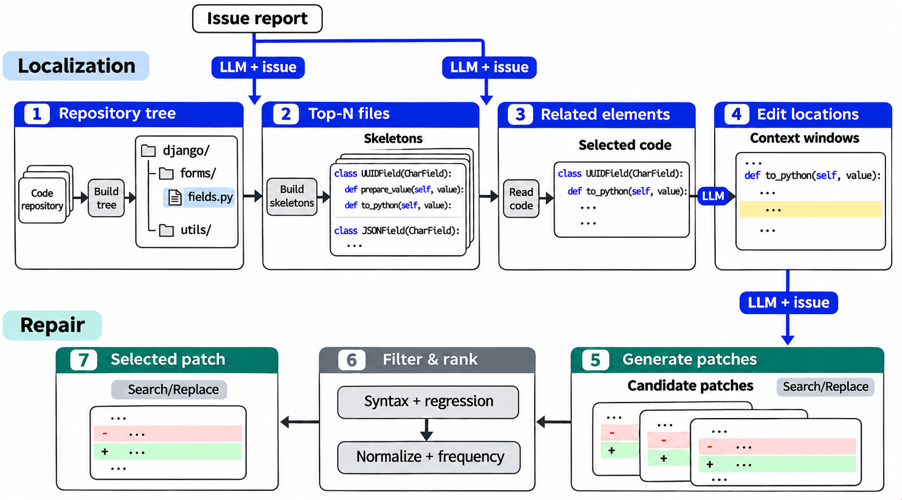

# Agentless narrative-first redesign

Current user feedback: **revise**. The user rejected the contribution emphasis as too procedural after this historical agent acceptance. See `user-feedback.json`; the accepted raster is retained as history, and native planning is disabled. Follow-up: `../2026-11-17-agentless-contribution/`. Exact skill-reference versions inspected in the historical source review are retained in `reviewed-skill-snapshot/`; their hashes were verified before the contribution-guidance update.

Date: 2026-11-17. Deliverable: an independently reviewed raster paper-method figure, plus the skill update and a post-freeze author-figure comparison. This is an author-informed redesign, not a new figure-hidden experiment or a benchmark of automatic design quality.

## Skill change

The existing single `paperfigure` skill now requires information selection and narrative abstraction before a new overview or material redesign. Its entry links to [paper-narrative.md](../../../paperfigure/references/paper-narrative.md); detailed guidance lives in references rather than the entrypoint. ImageGen, native-design and independent-review instructions route through that stage.

The data flow is source audit → narrative plan → reviewed figure-level abstraction/spec → communication brief → ImageGen → isolated pixel review → attached-image revision → frozen image. Full source evidence is retained separately from the main figure. The plan assigns main/internal/detail/record-only placement, reasons, source locators and visual ownership. Independent review assesses the central transformation, prominence, informative source representations, model versus deterministic roles, and final-width reading. A scientifically correct diagram can still fail narrative/design review.

## Scope and narrative choices

Source: [Agentless, arXiv:2407.01489v1](https://arxiv.org/pdf/2407.01489v1), Section 2, PDF pages 3–5. The PDF and author Figure 1 are retained in the earlier case's separate `comparison-after-freeze` folder; hashes are recorded in `run-context.json`. The raw PDF text and whitespace-normalized text used for this run are retained here. PDF column/figure interleaving remains visible in the raw extraction; source quotes and independent review constrain its interpretation.

This figure explains the paper concept, while the previous generated diagram explained a configured later code route. Minimum-failure cohorts, empty-cohort fallback, AST implementation details and output serialization are outside the new overview. They remain in earlier records rather than being silently reinterpreted as paper-v1 behavior.

The selected story is repository → file skeletons → related source code → edit locations with surrounding context, followed by patch sampling and compact deterministic filtering/ranking. The visual distinguishes LLM selection from tree/skeleton construction, source retrieval and tests/ranking. Class/function fragments derive from the paper's skeleton example and illustrate representation only; they are not an executed bug-repair case. Red/green diffs are reserved for generated/selected Search/Replace patches; no correctness or measured vote-count claim is made.

The two-row reading principle was chosen after the creator had seen the author figure. The independent reviewer received a fresh context and did not open the author diagram until after its own V4 raster verdict. Neither separation excludes pretrained model knowledge.

## Executed review and edit loop

Reviewer: `/root/agentless_narrative_review`, initialized with `fork_turns: none`. It did not author the spec, brief or images it accepted.

| Stage | Actual outcome |
| --- | --- |
| Source/narrative draft 1 | Revise: omitted deterministic tree construction, conflated selected files and skeletons, lacked explicit Search/Replace format, and overclaimed one direct issue input from prose. |
| Source/narrative draft 2 | Revise: exact original-versus-normalized output serialization was imported from later code without paper-v1 support. |
| Source/narrative draft 3 | Accept for candidate generation; exact source/spec/plan/brief hashes retained. |
| Image V1, initial generation | Revise: invented repair content appeared in localization context before patch generation; appearance also mismatched the flat brief. |
| Image V2, attached edit of V1 | Semantic/narrative pass: neutral source context plus highlighted interval, schematic patch strokes, corrected issue rail/model badge routing. Appearance still revise. |
| Image V3, attached edit of V2 | Scientific/narrative and routing pass; card shadows reduced, but broad phase-band gradients remained. |
| Image V4, attached edit of V3 | Accept for the exact raster: broad phase backdrops removed, phase chips retained, source story and routing preserved. Frozen before author comparison. |

Actual calls: one built-in ImageGen generation and three actual `referenced_image_paths` edits. Every submitted prompt, parent/input/output hash and rejected candidate is preserved. No paid external fallback, repair model, test harness or benchmark was run. V1 is 1684×934; edit outputs are 1685×934. This one-pixel drift is recorded rather than resampling the accepted target.

## Post-freeze comparison outcome

The independent comparison finds V4 stronger in first-pass sequence clarity, explicit model/deterministic roles and final-width scanability. The author figure retains stronger concrete issue/prompt and code-artifact grounding. V4 is consistent and clean but can feel generic; the creator also notes that the skeleton-to-selected-code contrast could be more tangible and the equal-card treatment remains prominent. This is a qualitative judgment, not a universal superiority claim or measured reader study.

Compared with the previous generated diagram, the new overview restores the paper narrative and removes competing implementation-branch detail. Because the scope changed from configured code to paper-v1, this is not a controlled same-information aesthetic comparison. The author-informed design process likewise does not repeat the previous figure-hidden test.

## Artifacts and acceptance boundary

- [Selected PNG](selected-reference.png), [freeze identity](selected-reference.json), [image-stage status](image-stage.json).
- [Narrative plan](narrative-plan.json), [figure spec](spec.json), [communication brief](design-brief.json), [semantic freeze](semantic-freeze.json).
- [Accepted source/narrative review](source-narrative-review-v3.md), [accepted raster review](image-review-v4.md), [round ledger](rounds.json).
- [Exact initial prompt](prompt-generate-v1.txt), [semantic correction](prompt-edit-v2.txt), [style edit](prompt-edit-v3.txt), [phase-background removal](prompt-edit-v4.txt).
- [Independent author comparison](author-comparison.md), [672px selected-image diagnostic](candidate-v4-paper-width.png), [672px author diagnostic](author-figure-1-paper-width.png).

The 672px views are seven-inch-at-96dpi diagnostics, not physical print measurements or a reader study. Equal width does not imply equal height; the old implementation diagram uses a wider aspect ratio, while the author crop also includes its caption.

The accepted artifact is raster only. Native feasibility is a reviewer inference from pixels; no native sample, SVG/PPTX authoring, Office rendering, editability acceptance or final native delivery was performed. `image-stage.json` therefore keeps `deliveryReady: false`. The exact image is ready for downstream reference-bound planning rather than generic auto-layout substitution.
