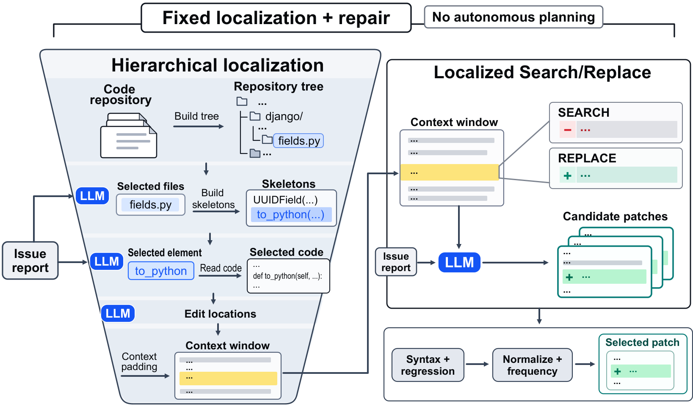

# Agentless: selected-image to editable SVG/PPTX

Date: 2026-11-17. Task: preserve the selected contribution-oriented design through native reconstruction, actual Office rendering and isolated review. This is reference-bound authoring, not generic method-graph auto-layout or automatic bitmap vectorization.

Final result: **accepted**. Shared delivery status reports mechanical, actual LibreOffice rendering and isolated review all passed (`deliveryReady: true`).

## Frozen target and authoring

Target: `../2026-11-17-agentless-contribution/selected-reference.png`, 1637×960, SHA-256 `8e42486349ee50cb69b29b9708c3347ad601252ef878e19b8ea1ac102db7fcfb`.

The target remains unchanged. [Independent reference inspection](reference-inspection.md) was written by the fresh-context reviewer before native exports were available. [Reference geometry](reference-geometry.json) records manually registered target anchors, crosschecked with that inspection, and was frozen before the final authoring revision. It is not recomputed from the exported SVG.

The shared [authoring source](author-scene.mjs) creates named native geometry, literal text and segmented connectors at source coordinates. Final authored inputs are under `source-v2/`, including the label/edge ledger, scene, frozen approximate typography and reference contract. The exported files are under `output-v2/`. `output-v1/` and its failed verification remain retained.

The fidelity target includes the fixed-control bracket, tapered localization funnel, source-representation stages, yellow source intervals, local Search/Replace magnification, patch stacks, issue bindings and subordinate validation strip. No modules or source relations were redesigned. A small local tree-ellipsis placement correction prevents an overlap with a folder glyph. Original raster typeface identity is unknown; Arial/Arial Narrow are explicit source-matched approximations, with literal text/positions/weights frozen and actual Office font coverage verified. Raster microtexture/subtle tint variation is approximated using editable solid vector fills.

## Native representation and verification

The final export has 26 semantic modules, 72 SVG text fragments and 19 source-visible edges. Actual PPTX ZIP/XML audit reports:

- 68 native text boxes covering all 72 SVG fragments, including 12 centered text blocks.
- 68 native shapes, 23 semantic connector segments and one native line-art object.
- 35 groups; 37 invisible connection-port helpers excluded from the 160 content-object denominator.
- Zero picture objects and zero media entries. Neither a full-slide screenshot nor an embedded full-figure SVG is used as the slide content.

The reference anchor check passes: maximum center deviation 1.118px, width deviation 4px and height deviation 3px. This checks anchors, not overall visual quality. Measured SVG ink/layout, native-object audit and frozen style checks pass. Actual LibreOffice→PDF→MuPDF rendering passes all 19 connector coverage checks (minimum 1.0), centered-text placement/wrapping checks and actual-font coverage for Arial/Arial Narrow. The full PNG, PDF and 672px paper-width diagnostics are retained.

## Retained failure and focused verifier repair

The first complete Office render visibly contained white LLM text on blue badges, but isolated-text checks removed the badge backgrounds and tested white glyphs against white pages using a dark-ink mask. Four `native-text-invisible` failures were therefore false positives. The original renderer snapshot is `verifier-before-white-text-fix.py`; the failed actual run is `output-v1/native-render/`.

The alpha-only hypothesis was checked and rejected because LibreOffice emits an opaque PDF page background. The focused fix in `paperfigure/scripts/render-layout.py` retains the native text objects unchanged, selects a contrasting matte per isolation slide, and computes contrast against that matte with the same 35-level floor. It does not change the delivered figure or loosen geometry, centering, wrapping or connector thresholds. Four real-PDF raster regressions pass: light/dark glyph bounds, mixed light/dark runs, blank mattes and exact equivalence to the previous dark-on-white detector. The final output was independently rendered again after this repair.

Matte isolation does not prove composed-slide contrast/occlusion; actual full SVG and Office pixels require independent review. The detailed diagnosis is in [white-text-verifier-fix.json](white-text-verifier-fix.json).

## Review and delivery

A separate reviewer `/root/agentless_native_review` was created with `fork_turns: none`. It did not author or modify the scene, exports, contract or validation reports. Its initial inspection and final source/SVG/Office comparison are separate from the creator's checks. The independent verdict is accept. The review confirms preservation of contribution hierarchy, source funnel, local-edit magnification, candidate overlap, arrows and paper-width readability.

- [Independent fidelity report](output-v2/native-fidelity-review.md), [hash-bound visual review](output-v2/visual-review.json), [separate editability/fidelity verdicts](output-v2/reconstruction-review.json).
- [Editable SVG](output-v2/editable.svg), [editable PPTX](output-v2/figure.pptx).
- [Actual Office PDF](output-v2/native-render/figure.pdf), [Office preview](output-v2/native-render/preview.png).
- [Target / SVG / Office comparison](output-v2/target-svg-office.png), [Office at paper width](output-v2/office-paper-width.png).
- [Scene](output-v2/layout-scene.json), [reference contract](output-v2/reference-contract.json), [source transcript](output-v2/reference-transcript.json), [native object map](output-v2/pptx-object-map.json).
- [Native audit](output-v2/native-audit.json), [Office checks](output-v2/native-render/render-qa.json), [actual-font QA](output-v2/typography-qa.json), [delivery status](output-v2/delivery.json).

The Office engine is LibreOffice, not an interactive Microsoft PowerPoint session. Text/shapes/connectors are natively represented, but human editing cost and exact Microsoft PowerPoint appearance are unverified. Multi-segment connector endpoints are bound to grouped port helpers; intermediate bends can require manual adjustment when moving modules. Source font identity and raster texture remain approximate. Fidelity acceptance applies to this exact target and these inspected outputs, not automatic high-quality conversion of arbitrary figures.
